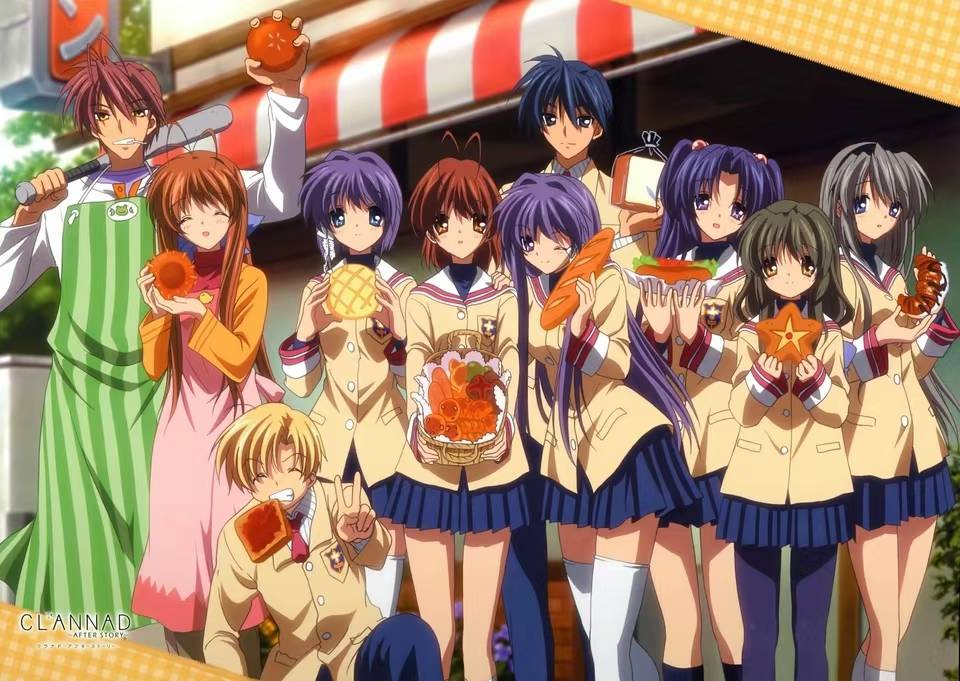

### 2023 年终总结

一月，寒假，阳康摆烂+缓考考试，回家过年。

二月，游武汉，提前回校，游北大，被缓考的考试爆了。

三月，面试答疑坊志愿者（没面上），以及担任 Overflow 学生节的技术支持工作。月末赶了铃芽之旅的大陆首映，算是一场新海诚的电影没落下。

四月，大赶软工。月末去了 IJOY 漫展，狠狠集邮。

五月，劳动节假期爸妈来北京了，带他们逛了清华。初中好兄弟有朋来北京了，也带他逛了清华。之后疯狂 rush 软工直到验收。520 本人和软工代码度过。月末软工验收完毕，去看了刀剑神域进击篇的剧场版，我还是喜欢结城明日奈。

六月，或许最重要的事情就是当选了计算机系科协网络部副主席吧。嗯，还有曼城夺得了三冠王？考完期末一周疯狂 rush 图形学大作业，之后就开始了迟到两年的一字班军训。

七月，拉练，军训结束，小群海底捞大聚餐，前往西安访友。之后从西安回家。再从家回北京。再从北京回家。

八月，前往南京实践，瞻仰南京外国语学校。之后又前往昆明实践。月末回到了学校。同时第一次担任助教，成为微积分B教学团队的一员。

九月，看了奥本海默，神中神。推了 clannad galgame。科协迎新。坚持上课只坚持了一个星期。月末跟吉大师和周公子高中毕业后时隔两年再度相见，个中感情无可言说。

十月，国庆假期爸妈来北京出差，陪他们吃了饭。还去了北师大逛了一圈。之后过二十岁生日。上第一次习题课，感谢我小班上所有同学的包容。

十一月，月初临时起意去了天津一趟。一个人度过了第二十个光棍节。之后就是在课程的任务和英超联赛的赛程中，时间飞速度过。

十二月，造机。造机结束作为 Ninetune 学生节的技术支持总负责，算是圆满完成了任务。之后选课发现下学期还是要上好多课啊！再之后到今天……此时的我刚睡醒，写下来这篇总结。

过去的一年算是在自我身份认知和探寻上有了不小的突破吧。就跟去年的年终总结我提出的希望一样，我获得了、加深了更多我觉得珍贵的人与人之间的连接，与父母、同学，这是非常可贵的事情，是我能乐观生活下去的动力。这一年工作颇有些多了，新的身份也很多。副主席、助教，责任也变得更多。学期初觉得给自己找了太多事，不过现在想来还是感到幸运。自己愿意给自己找事，锻炼了自己的能力，认识了更多朋友。希望科协的工作越办越好，希望我小班的同学的学习一路顺利，希望我自己在 2024 年有一个更加平和成熟的心态，真正成为一个 2 打头年龄的人。

Happy New Year to everyone！

2023.12.31 夜

{.article-illustration width="960" height="681" loading="lazy" decoding="async"}
